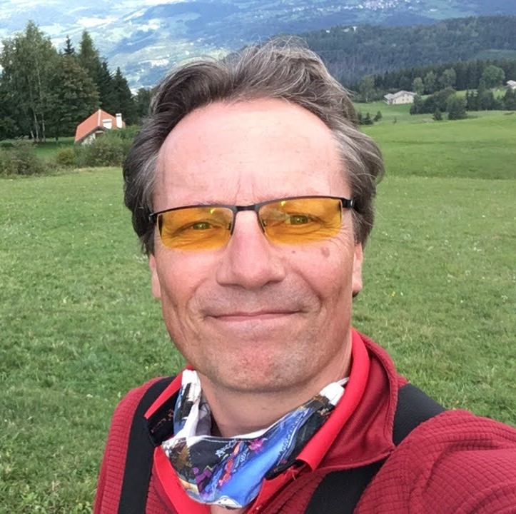

# Who is Bennert

I am Bennert de Wijs, a Senior Test Automation Engineer and high-tech specialist from Veldhoven. My work often starts with a question: how does this system really fit together, and how could it work smarter?

With a background in electronics (MTS) and computer science (HTS), I enjoy moving between physical technology and abstract software. That intersection is where I make sense of complex systems, connect the dots, and make processes clearer and easier to manage.

## Turning complexity into clarity

From medical imaging and DICOM to high-tech development environments, complex technology calls for more than running tests. I look at how components, data, teams, and processes fit together. Where are the risks? What feedback do developers need? And how can we make quality part of the work from the start?

## Smart automation creates room

I started out building software as a Software Engineer; today, as a Test Automation Engineer, I help teams deliver faster and with greater confidence. I set up the continuous integration process for the [Philips Hue](https://www.philips-hue.com/) project using [Jenkins](https://www.jenkins.io/). I later applied that experience with the UroNav team, adding test automation and automated test reporting, and at Uplanner to improve continuous integration and continuous delivery.

Automation is not an end in itself. Well-designed frameworks, reliable feedback, and a thoughtful CI/CD pipeline remove unnecessary manual work and uncertainty. That brings calm to the development process and gives people room for creative problem-solving. So I think beyond the tests themselves, contributing to the architecture, structure, and improvements that make the whole process simpler.

## A thread of curiosity

My curiosity extends beyond work. With home automation, I explore how technology can make everyday life smarter; paragliding lets me experience how people, equipment, and conditions form a single system. I bring that same curiosity to software testing and framework design: understand how something works, see what could be possible, and turn ideas into something genuinely useful.

I learn quickly, enjoy looking beyond the usual approach, and thrive on meaningful improvement. I am looking for projects where I can untangle complex challenges and work with a team to build systems and processes that are simpler, more reliable, and better to work with.

Handball and scouting have also been important parts of my life. From age six to twenty-six, I was involved with [Scouting Netherlands](https://www.scouting.nl/), first as a member and later as a leader and scoutmaster. Helping people grow and finding better ways to work together energized me there, too.
